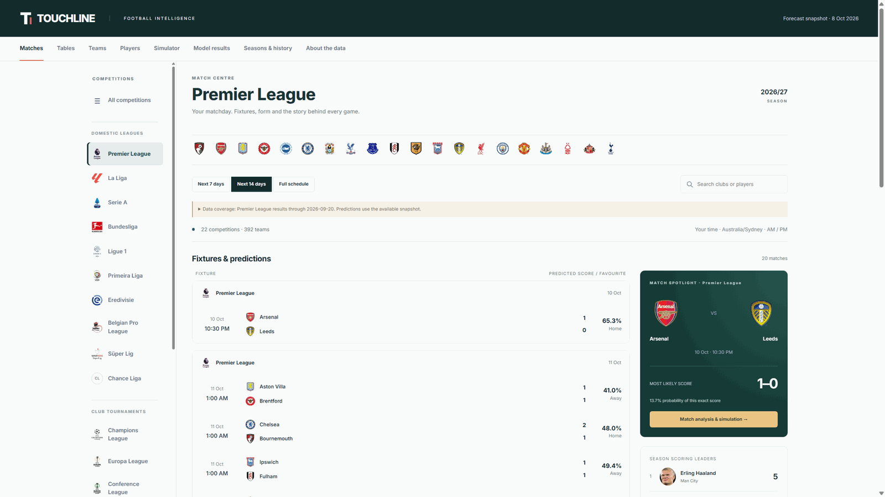

<p align="center">
  
</p>

<p align="center">
  
  
  
  
</p>

<h1 align="center">Touchline</h1>

<p align="center"><strong>Football predictions, match simulations and club and player history, in the browser.</strong><br>
22 competitions in one match centre. Refreshes itself daily, with AI-written previews for upcoming fixtures.</p>

<p align="center">
  <a href="https://football-prediction-engine-cyan.vercel.app/"><strong>Open Touchline</strong></a> &nbsp;·&nbsp;
  <a href="#whats-inside">What's inside</a> &nbsp;·&nbsp;
  <a href="#how-it-works">How it works</a> &nbsp;·&nbsp;
  <a href="#build-and-run">Build and run</a> &nbsp;·&nbsp;
  <a href="#project-structure">Project structure</a>
</p>

## What's inside

- **Fixtures and forecasts** for 22 competitions: score probabilities, expected goals, over 2.5 and both teams to score.
- **Match spotlight** with the most likely score, an AI-written preview for upcoming fixtures, and a question box that answers from the forecast facts shown on the page.
- **Weekly AI recaps** summarising the last seven days of results for each competition, using only the saved scores.
- **Match simulator** with formations, a replay, events, pause and skip, reproducible seeds, and a 10,000-run comparison.
- **Club and player profiles**: squads, form, managers, stadiums, honours and career histories.
- **Honest backtests**: outcome and exact-score hit rates, log loss and Brier score, with the forecast cutoff shown.

## How it works

- **Forecasts come from a Rust model** in `crates/predictor`, built from saved match data. Every forecast is dated, so the cutoff is always visible.
- **The site is built from saved data.** `tools/build_website.cjs` compiles the dashboard and packages it as static pages with on-demand JSON. No server is needed to view it.
- **Results refresh daily.** A scheduled workflow pulls open results from openfootball, moves the forecast date to today, rebuilds, and republishes. It only commits when the data changes.
- **AI features are cached.** Fixture previews (`data/ai/previews.json`) and weekly recaps (`data/ai/recaps.json`) are generated once per item by the DeepSeek API. The question box runs as a Vercel serverless function (`api/match-question.js`), with a per-visitor limit.

## Build and run

Requirements: stable Rust and Node.js 20 or later.

```bash
node tools/build_website.cjs            # build the site into dist/
node tools/serve_dashboard.cjs dist/index.html
```

Open http://127.0.0.1:8765/. Previews need a `DEEPSEEK_API_KEY` in the environment. Without one, the site builds and simply shows no previews.

Run the checks:

```bash
cargo test --locked -p predictor
node --test crates/predictor/web/*.test.cjs
```

## Configuration

| Variable | Where | Purpose |
| --- | --- | --- |
| `DEEPSEEK_API_KEY` | GitHub Actions secret | AI match previews during the scheduled build |
| `DEEPSEEK_MODEL` | Optional | Model name. Defaults to `deepseek-chat`. |

## Data and licences

- **Results:** [openfootball](https://github.com/openfootball/football.json), public domain.
- **Team and player profiles and images:** bundled from the sources recorded in `data/`. Each image keeps its own credit and licence, which the site shows.
- **Code:** dual-licensed under MIT or Apache-2.0.

Forecasts are statistical estimates for analysis and entertainment. They are not betting advice.

## Project structure

```
crates/
  predictor/        forecasting model, backtests and the dashboard generator
  football_ai/      match simulation engine
  football_sandbox/ tactical sandbox (development tool)
data/               saved results, catalog, profiles and AI previews
tools/              build, refresh and publishing scripts
.github/workflows/  scheduled refresh and publishing
docs/               website publishing notes and screenshots
```

## Licence

MIT or Apache-2.0, at your option.
