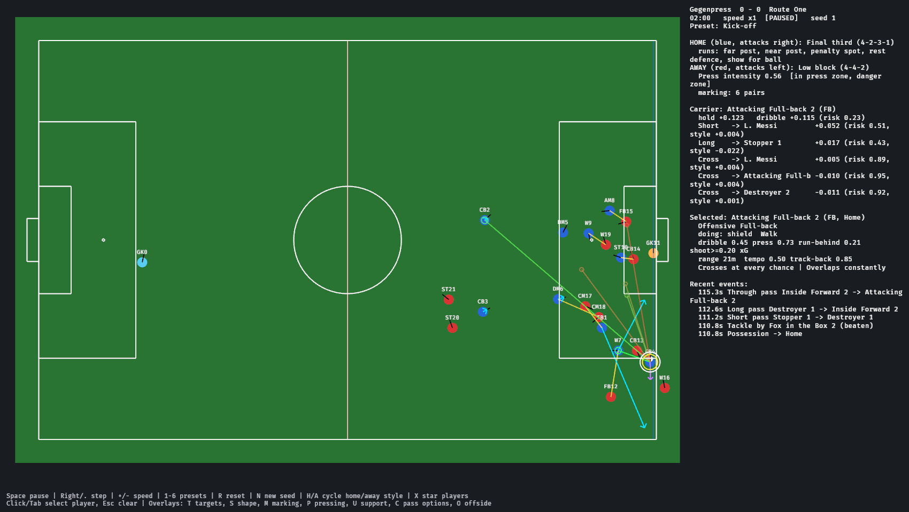

<p align="center">
  
</p>

<h1 align="center">Touchline</h1>

<p align="center"><strong>Football predictions, match simulations and club/player history — in the browser.</strong><br>
22 competitions, one match centre. No backend, no API key, no install.</p>

<p align="center">
  <a href="https://ykyritsis.github.io/football-prediction-engine/"><strong>Open Touchline</strong></a> &nbsp;·&nbsp;
  <a href="#whats-inside">What's inside</a> &nbsp;·&nbsp;
  <a href="#screenshots">Screenshots</a> &nbsp;·&nbsp;
  <a href="#project-structure">Project structure</a>
</p>

<p align="center">
  
  <br><sub>The match centre: fixtures, predicted scores and the match spotlight, generated from a dated data snapshot.</sub>
</p>

## What's inside

- **Fixtures and forecasts** across 22 competitions: score probabilities, expected goals, over 2.5 and both-teams-to-score.
- **A match simulator** with formations, a five-second replay, events, pause/skip, reduced motion, reproducible seeds and a 10,000-run comparison.
- **Club and player profiles**: squads, form, managers, stadiums, honours, contracts, portraits and career histories.
- **Honest backtests**: 1X2 and exact-score hit rates, log loss and Brier score, with the cutoff visible instead of hidden.
- **A static build**: `dist/index.html` plus on-demand JSON, so it runs on GitHub Pages with no server.

## Screenshots

<p align="center">
  
  
  <br><sub>The tactical simulation sandbox in <code>crates/football_sandbox</code> — a separate development tool, not an input to the statistical forecasts.</sub>
</p>

---

## Public website

The public edition runs on GitHub Pages from saved data. It needs no local
installation or backend, and all match simulations run in the browser.
Only bundled Transfermarkt histories are available on the public site;
additional histories can be collected locally and included in a later edition.
The forecast date and latest result dates are visible in the app.

Build the same website locally with Node 20+ and stable Rust:

```sh
node tools/build_website.cjs
```

The output is `dist/index.html` and on-demand JSON files in `dist/assets/`, with
no server-side dependencies. Preview with `node tools/serve_dashboard.cjs dist/index.html`. See
[website publishing and data updates](docs/WEBSITE.md).

## Local dashboard

Generate a browser match centre for 22 competitions: ten domestic leagues,
Champions League, Europa League, Conference League, Club World Cup and eight
national-team competitions. The domestic additions are Portugal, Netherlands,
Belgium, Türkiye and Czechia:

```sh
cargo run --release -p predictor --bin dashboard -- 2026-10-08 dashboard.html
```

Open `dashboard.html` in any modern browser. Predictions and tables work offline,
with no server, API key or JavaScript build. Club/competition logos, credited
player photos and the Inter font load remotely. The date is an explicit **as-of
cutoff**, not an automatic assertion that the data is current. Update it when
generating a new snapshot. The optional third argument chooses the historical
evaluation start date (default: 90 days before the cutoff):

```sh
python tools/fetch_results.py 2026-27
node tools/sync_catalog.cjs --year=2026 --refresh
cargo run --release -p predictor --bin dashboard -- 2026-10-08 dashboard.html 2025-08-01
```

The fetch script prints failures and retains older files if a source is
unavailable. Check its output and the dashboard's latest-result dates before
treating forecasts as current. `PREDICTOR_DATA` overrides `data/results`; match
statistics are loaded from the adjacent `stats` directory. The result refresh
script does not refresh the separate statistics files.
`sync_catalog.cjs` refreshes public ESPN club profiles, competition-scoped player
statistics, kickoff/venue metadata and European fixtures/results. It also fetches
credited Wikimedia portraits for selected leading players, verifying identity
against the provider's date of birth. See `data/catalog/README.md` for coverage,
cache behavior and source limitations.

- **Upcoming fixtures:** league and club filters, score probabilities, home /
  draw / away chances, model expected goals, over 2.5 goals and both teams scoring.
- **Match simulator:** two registered teams within one competition, with
  a five-second default replay, smooth pitch and ball animation, automatic team formations,
  progressively revealed shots/goals/scorers/assists, pause, skip
  and reduced-motion support. Each run uses a new random seed; optional fixed
  seeds reproduce both score and events. A collapsible 10,000-run comparison
  distinguishes a sampled match from the forecast distribution.
  Defaults use the most common shape in up to five recorded XIs from the last
  180 days, breaking ties by the latest use. Teams without recent records show
  their last recorded shape or an explicitly labeled suggestion. Manual changes
  stay with that team for the browser session; Reset restores its recorded default.
  A complete recent recorded XI in the chosen shape is reused when all its players
  remain in the saved squad; otherwise selection uses appearances and positions.
- **Team profiles:** crests, dated managers, stadium imagery/capacity, honours,
  current-season summaries, upcoming matches, full squads, recent results and
  the latest recorded XI on a formation board.
  Overview, Squad, Tactics, History and Matches tabs keep each profile navigable;
  squad cards open individual player profiles. Match analysis links both team profiles.
- **Player profiles:** nationality, age, shirt number, position, available goals,
  assists, appearances, shots, cards and goalkeeper stats, per-appearance rates,
  shot efficiency, position-peer comparisons, recent match performances,
  cross-competition totals and verified contract/market-value details. Values are scoped to
  the selected competition; missing stats remain missing. Verified portraits
  link the original creator, file and license. Profiles are descriptive, not
  additional inputs to the team prediction model. Upcoming matches include
  experimental anytime-goal/assist estimates from competition-specific squad
  shares, with position smoothing and a 70% assisted-goal prior. They have no
  confirmed lineup/minutes/injury inputs and are not calibrated player forecasts.
  Player profiles have Overview, Stats, Matches and Career tabs. On phones,
  bottom navigation and a grouped competition selector replace the desktop menus.
- **Recent form:** each club's last five available competition results, including
  opponent, venue and score on hover. Recency affects the underlying model
  through the base one-year half-life. The dashboard additionally applies
  opponent-adjusted last-five attack/defence residuals with six pseudo-goals,
  exponent 0.35 and strength caps of 0.85–1.15 (the base model spread still
  applies). Good/mixed/poor badges describe points per game, while the displayed
  numerical adjustment describes performance against expectations.
- **Past predictions:** green checks for correct 1X2 picks, red crosses for
  incorrect picks, gold exact-score badges, predicted versus actual scores, training
  cutoffs, outcome and exact-score hit rates, log loss and Brier score. Fits use
  only earlier matches and are reused for seven-day windows. Evaluation skips
  windows with fewer than 100 earlier competition results.

Historical rows are reconstructed backtests, not saved pre-match forecasts.
Model settings may have been tuned over overlapping history, so these are not
untouched holdout scores. Simulation samples the statistical score distribution.
This dashboard does not apply current
manual team-news adjustments, injuries or live lineups. European forecasts are
an experimental baseline fitted to each cup's history, including qualifying
rounds. They cover 90 minutes, not aggregate ties, qualification, extra time or
penalties. Neutral venues remove both league and club home advantage. The import
omits games ending after extra time or penalties when no regulation score is
provided; it does not mistake those final scores for 90-minute results.
It exposes stale data and unresolved past fixtures instead of silently treating
them as future matches. All future fixtures use strengths at the snapshot cutoff.

### Historical data through Transfermarkt

The adapter uses [felipeall/transfermarkt-api](https://github.com/felipeall/transfermarkt-api).
Run Node 20+ from the repository root:

```sh
node tools/transfermarkt.cjs 2026
cargo run --release -p predictor --bin dashboard -- 2026-10-08 dashboard.html
node tools/serve_dashboard.cjs dashboard.html
```

Open `http://127.0.0.1:8765/`. `Seasons & history` offers historical tables
(including cup group/league phases) and the bundled match archive. Club profiles
show season summaries and load honours/heritage. Player profiles load career
statistics, transfers, honours and a market-value timeline after a verified name
and birth-date match. The local server retrieves extra histories on demand;
saved enrichments are included in the next generated standalone HTML.

The expanded snapshot contains 392 club/national profiles, 11,411 roster entries
and more than 6,400 portrait links, plus verified honours and stadium details
where returned by the provider. Detailed player career histories are available
for selected players; missing histories and photos remain clearly marked.
Requests are serialized at least 1.65 seconds apart, and raw responses are cached
for 24 hours. Successful normalized enrichments persist in
`data/catalog/transfermarkt.json`; their upstream timestamps remain visible.
`TRANSFERMARKT_API_URL` can point at a self-hosted instance of the same API.
The default hosted API is intended for testing. Its code license does not grant
rights to Transfermarkt data; see the upstream project for usage terms. The
server binds only to loopback and is a local preview, not a production service.

The dashboard goal level is reconciled to the previous 90 days, using 40
pseudo-matches, a minimum of 20 real matches and a 0.90–1.15 multiplier cap.
It runs after the recent-form adjustment. Both use only earlier results in
backtests. The baseline CLI remains available without these dashboard additions.
A low most-likely exact score is not a low expected match total. These heuristic
additions need independent future validation; they do not establish better
predictive accuracy.

Validation:

```sh
cargo test -p predictor --locked
node --test crates/predictor/web/*.test.cjs
```

The exporter is `crates/predictor/src/bin/dashboard.rs`; its typed data assembly
is in `src/dashboard.rs` and the dependency-free browser UI is in `web/`.
Generated HTML is a build output and is not committed.

For a future live-data release, add a maintained fixtures/results ingestion service and
an immutable archive of forecasts with model versions. Lineup and injury feeds
and additional short-term form features should be evaluated on a later holdout
period before changing the default model.

National-team competitions share a deduplicated national result pool and keep
their own fixture/archive scope. Training and historical evaluation enforce the
same date cutoff; domestic club results do not enter that pool. Hypothetical
international matches use a neutral venue. These forecasts are an experimental
baseline, not evidence of improved predictive accuracy.

## Command-line predictions

The Rust model also exposes match forecasts, fixture forecasts, season projections
and evaluation through the CLI:

```sh
cargo run --release -p predictor --bin predict -- match premier_league liverpool "man city" "M Oliver"
cargo run --release -p predictor --bin predict -- fixtures all 4
cargo run --release -p predictor --bin predict -- table premier_league
cargo run --release -p predictor --bin predict -- backtest all 2024-08-01
```

## Project structure

| Directory                                       | Purpose                                                             |
| ----------------------------------------------- | ------------------------------------------------------------------- |
| `crates/predictor`                              | Statistical forecasting model, dashboard exporter and browser UI    |
| `data/results`, `data/stats`                    | Saved match results and supporting statistics                       |
| `data/catalog`                                  | Clubs, squads, competition metadata and saved historical enrichment |
| `tools`                                         | Data refresh, historical adapters and website build                 |
| `crates/football_ai`, `crates/football_sandbox` | Optional tactical simulation library and visual development sandbox |

The tactical simulation is a separate development tool. Its ratings and
illustrative squads are not inputs to the statistical match forecasts.
See [tactical simulation documentation](docs/SIMULATION.md) for its setup and API.

Code is licensed under MIT OR Apache-2.0. Upstream football data, photography
and marks retain their separate source terms and attribution requirements.
