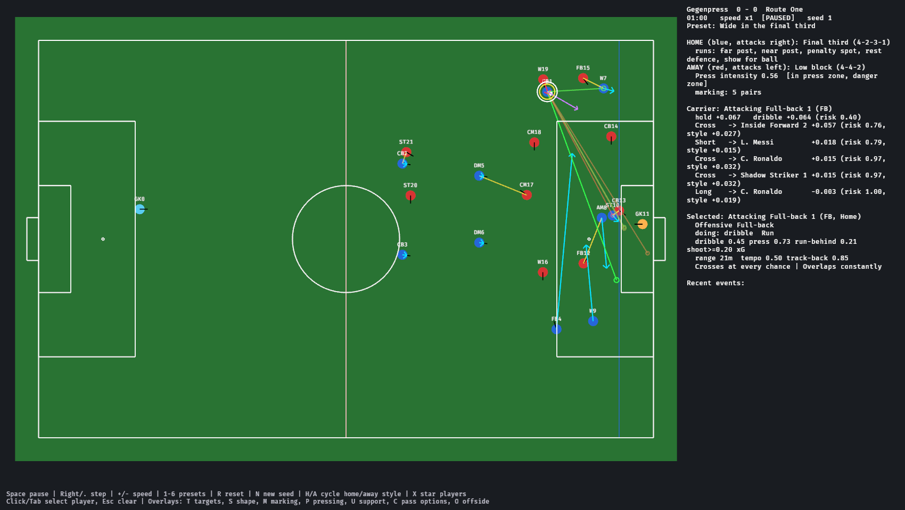
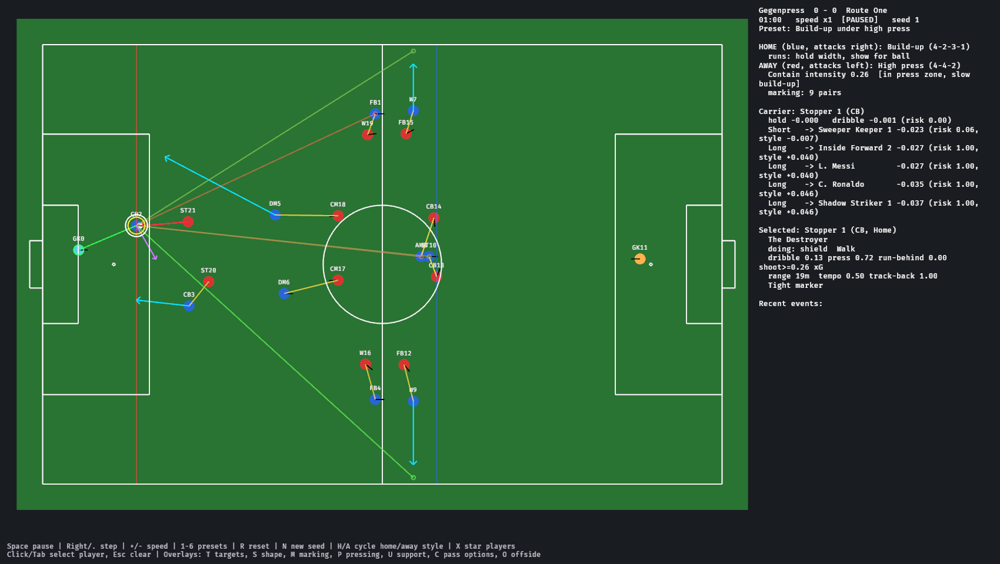

# pes18-recomp — football AI

A deterministic, headless football simulation and tactical decision layer in
Rust, built as the "brain" for a PES 2018-style game, plus a Bevy sandbox for
inspecting it.



| Crate | What it is |
|---|---|
| [`crates/football_ai`](crates/football_ai) | Zero-dependency library: 22 players + ball, formations, phases, pressing, marking, support runs, passing evaluation, role behaviour, team/player identity, fixed-step simulation |
| [`crates/football_sandbox`](crates/football_sandbox) | Bevy 0.19 app that runs the simulation and draws every decision |

## Quick start

```sh
cargo test -p football_ai                                         # ~100 tests, a few seconds
cargo run --release -p football_ai --example headless_match -- 7 90 tiki-taka long-ball
cargo run --release -p football_ai --example style_report -- 90 2  # round-robin of team styles
cargo run -p football_ai --example describe                        # generated team/player descriptions
cargo run --release -p football_sandbox                            # visual sandbox
```

On Linux the sandbox uses X11 by default (works under XWayland); build with
`--features wayland` for native Wayland (needs `libwayland-dev`).
`SANDBOX_CAPTURE=<dir> football_sandbox` captures a screenshot of every preset and exits.

## What the AI does

Every tick, each team builds a **team plan** from an immutable snapshot, then
each player makes a **decision** from that snapshot and his team's plan.

| Behaviour | Module | Summary |
|---|---|---|
| Formation-relative positioning | `formation` | Slots in normalised block coordinates, stretched per phase: line height follows ball and phase, compact/wide in and out of possession, slides to the ball, holds onside, drops off when the passer has time, sweeper-keeper |
| Possession phases | `phase` | Build-up / progression / final third / attacking transition, and high press / mid block / low block / defensive transition, with hysteresis |
| Pressing triggers | `pressing` | Backward pass, receiving touch, facing own goal, touchline, isolated carrier, press zone, slow build-up, danger zone, counter-press. Intensity decides press vs contain; cover-shadow player; gegenpress swarm |
| Defensive marking | `marking` | Zonal-man hybrid, deterministic greedy assignment, positional leashes, goal-side anticipation, tightness by danger and instructions |
| Support runs | `support` | Rest defence, near/far post, penalty spot, cut-back, runs in behind timed to the passer, overlaps/underlaps, showing for the ball into free pockets, holding width |
| Passing evaluation | `passing` | Short / through / long / cross candidates; interception risk from lane timing (lofted balls only contestable at landing, aerial duels), misplacement, receiver pressure, progression, lines broken, offside excluded |
| On-ball choice | `decision`, `eval` | Pass vs shot (xG) vs carry vs shield on one expected-value scale, with identity as style utility |
| Laws of the game | `rules` | Fouls from challenges (angle, skill, aggression, bookings, own box), advantage with call-back, yellow/red cards incl. second yellows and denial of a goal-scoring chance, sending-offs (the team plays a man short), direct/indirect free kicks with walls, penalties, two halves with stoppage time; referees have a style (`Referee::strict()`, `lenient()`) |
| Stamina and substitutions | `sim` | Energy drains with running (faster for low stamina); tired players lose up to 20% speed and press less, so pressing teams fade late. Benches of seven; the manager AI makes up to three substitutions at dead balls: injured players at once, tactical changes for the score from the 60th minute (an attacker on when chasing, a defender when protecting a lead), and tired players from the 55th, each time bringing on the best fit for the position |
| Injuries | `sim` | Fouls (especially from behind) and exhaustion can injure a player, less often for high injury resistance; injured players are slowed and replaced at the next dead ball |
| Game management | `tactics::Mentality` | From the 60th minute teams adapt to the score: chasing (higher line, harder press, more direct, more risk), all-out attack after 80', or protecting a lead after 75' (deeper, cautious, forward kept as an outlet) |
| Simulation | `sim` | Fixed step, steering, rolling and lofted ball flight, selective tackling, saves, offside, throw-ins, corners, goal kicks, kick-offs, event log |

## Team and player identity

The `identity` module mirrors PES 2017/2018 so the full game can be filled in
directly from the extracted database:

* **Players**: 40–99 `Ratings`, a `PlayingStyle` (Goal Poacher, Creative
  Playmaker, Anchor Man, …), `ComStyle`s (Mazing Run, Long Ranger, Early
  Cross, …) and `Skill`s (Double Touch, Through Passing, Man Marking, …). Each
  trait has a description and a concrete effect on decisions.
  `PlayerProfile::behaviour_in(role)` layers them over the role defaults, so a
  dribbler stays a dribbler in any position.
* **Teams**: `TeamStyle` is the PES game plan (attacking style, build-up,
  attacking area, positioning, support range, defensive style, containment,
  pressuring, defensive line, compactness, advanced instructions such as
  Tiki-Taka, Gegenpress, Counter Target, False No. 9). It compiles to numeric
  `Tactics`.
* **Descriptions** are generated: `TeamStyle::describe()`,
  `PlayerProfile::describe()`, `signature_traits()`.

```text
L. Messi (W) — Creative Playmaker. Creates chances out of nothing with vision, dribbling and incisive
passing. Standout abilities: ball control 97, dribbling 97, balance 95. On the ball: Trickster, Mazing Run,
Long Ranger. In matches: Takes defenders on; Clinical finisher; Shoots from distance; Plays killer through balls.
```

`presets` has six team archetypes, twenty player archetypes, generated
squads that suit each style, and two example star profiles. The star
profiles' ratings are illustrative placeholders: real values should come from
the game data.

### Does identity change the football?

Round-robin of the archetypes (`style_report`, 90 min, every pairing home and away):

| Style | Poss | Avg pass | Long % | Crosses | Shots | Goals | PPDA |
|---|---|---|---|---|---|---|---|
| Tiki-Taka | 63% | 13.0 m | 11% | 2 | 22 | 1.8 | 2.0 |
| Gegenpress | 52% | 21.9 m | 26% | 5 | 31 | 4.2 | 2.6 |
| Route One | 47% | 32.5 m | 61% | 37 | 11 | 1.9 | 4.5 |
| Counter-Attack | 51% | 23.7 m | 27% | 45 | 16 | 2.1 | 3.2 |
| Wing Play | 47% | 21.0 m | 26% | 21 | 9 | 1.4 | 3.4 |
| Park the Bus | 39% | 28.5 m | 42% | 1 | 5 | 0.7 | 7.6 |

(PPDA = opponent passes per defensive action in the pressing zone; lower =
more intense pressing.) A full match also produces football-like discipline:
around 20 fouls, 2–4 yellow cards, the occasional red and penalty.

Tests pin the important contrasts: long-ball teams play longer, possession
teams keep the ball, pressing teams win it higher, dribblers carry more,
finishers rate chances higher.

## Determinism

* One seeded RNG, consumed only by the simulation, in a fixed order.
* Planning and decisions are pure functions of the snapshot, so their order
  does not matter (tested by deciding in reverse order).
* Every sort has an explicit tie-break; there are no hash maps; search
  directions are constant tables.
* `MatchState::state_hash()` is bit-exact; tests run two simulations side by
  side and compare hashes every tick.

Results are identical on the same platform and build. A few `exp`/`atan2`
calls go through the platform maths library; for cross-platform lockstep
networking, swap those for a portable implementation.

## Integrating with Bevy ECS

The decision layer is two pure functions:

```rust
plan_team(&MatchState, TeamSide) -> TeamPlan
decide(&MatchState, &TeamPlan, PlayerId) -> Decision
```

A game maps them onto systems:

```rust
// 1. Copy components into a snapshot (22 players + ball is a tiny copy).
fn snapshot(q: Query<(&Slot, &Transform, &Velocity, &Identity)>, ball: Res<BallState>, mut snap: ResMut<Snapshot>) { /* fill MatchState */ }
// 2. One plan per team.
fn plan(snap: Res<Snapshot>, mut plans: ResMut<TeamPlans>) {
    plans.0 = [plan_team(&snap.0, TeamSide::Home), plan_team(&snap.0, TeamSide::Away)];
}
// 3. Decisions in parallel: they only read the snapshot.
fn decide_players(snap: Res<Snapshot>, plans: Res<TeamPlans>, mut q: Query<(&Slot, &mut DecisionC)>) {
    q.par_iter_mut().for_each(|(slot, mut d)| d.0 = decide(&snap.0, &plans.0[slot.0.team().index()], slot.0));
}
// 4. Locomotion / animation / ball physics consume `DecisionC` (see `sim.rs` for a reference).
```

The sandbox keeps the whole `Simulation` in a resource instead, so what you
see is exactly what the headless tests run.

## Sandbox



| Key | Action |
|---|---|
| Space / → or `.` | pause / single step |
| `+` / `-` | speed ×2 / ÷2 |
| `1`–`6` | presets: kick-off, build-up under press, midfield progression, wide final third, counter-attack, low block |
| `R` / `N` | reset preset / new seed |
| `F` | whistle a foul on the ball carrier (free kick, penalty, cards) |
| `I` | injure the selected player |
| `H` / `A` | cycle home / away team style |
| `X` | toggle the example star players in the home team |
| Click / Tab / Esc | select player / cycle / clear |
| `T` `S` `M` `P` `U` `C` `O` | overlays: movement targets, formation shape, marking, pressing and cover, support runs, pass options, offside lines |

Overlay colours: yellow = marking (brighter = tighter), red = press/contain,
orange = cover shadow, cyan = support runs, green→red lines = the carrier's
pass candidates ranked, purple arrow = best carry. The HUD shows each team's
phase, pressing mode and triggers, active runs, the carrier's scored options,
the selected player's identity and behaviour numbers, and recent events.

## Status and roadmap

Calibration is ongoing. Possession, passing, pressing intensity, crossing,
discipline, fatigue and shot accuracy are in a football-like range: about two
thirds of shots hit the target, keepers save around 80% of those, and a match
averages about four goals (real football: 2.7). The decision layer's xG is
scaled to what shots actually score (`XG_EXECUTION`). Gegenpress still creates
the most chances (about 30 shots); Park the Bus and Wing Play the fewest.
`style_report`, `headless_match` and the SVG snapshot renderer
(`football_ai::svg`) are the tuning tools.

Teams change ends at half-time. Internally Home always attacks `+x` (the AI
is symmetric); `MatchState::ends_swapped` and `display_pos()` tell the
presentation layer to mirror the pitch, which the sandbox and SVG renderer do.

Not modelled yet: handball, and ball height (lofted balls are approximated by
an airborne distance).

Next:

1. Calibrate chance creation against PES 2018 match statistics.
2. Fill identities from the extracted PES 2018 database.
3. Formation changes from the bench; player and team data import format.
